# Keyboard Builder Simulator

Mô phỏng quy trình build bàn phím cơ: nhận đơn, mua linh kiện, lắp ráp và giao hàng.
Ứng dụng được xây dựng bằng React, TypeScript, Vite, Tailwind CSS và React Three Fiber.

Các file CAD bàn phím, case, plate và PCB công khai dùng làm nguồn cho game nằm tại [assets](assets/README.md) (chia theo nhóm: `keyboards/<tên>/`, `switch/`, `stab/`, `keycaps/`, `plates/`, `tools/`...), kèm nguồn và giấy phép.

## Ảnh demo

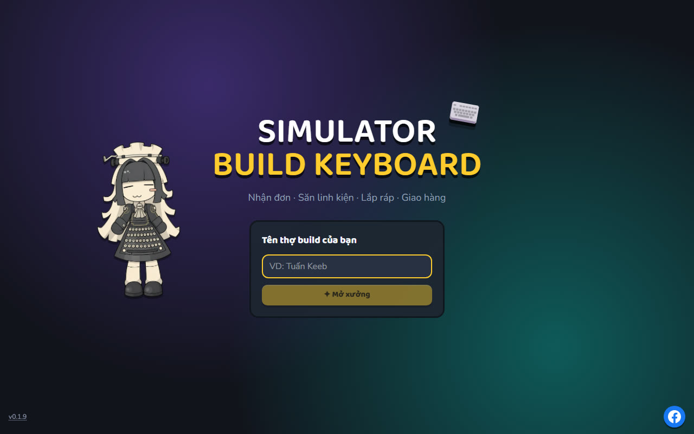

| Nhận đơn ở Mezzenger                               | Mua đồ ở Shopii (Sách phép)                          |
| -------------------------------------------------- | ---------------------------------------------------- |
| 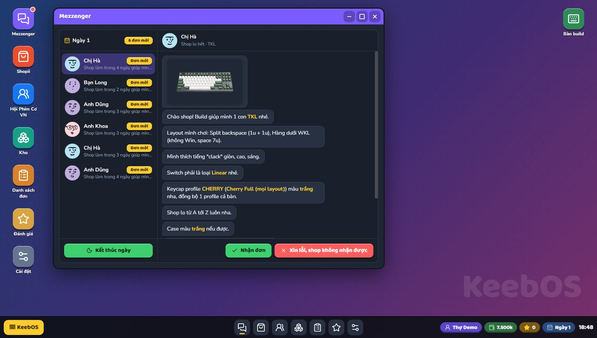            | 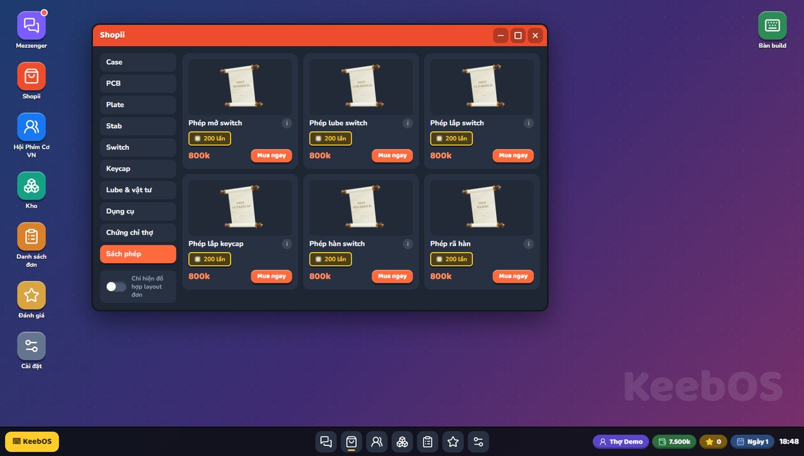          |
| **Bàn build 3D: lắp keycap**                       | **Bàn lube: mở và lube switch**                      |
| 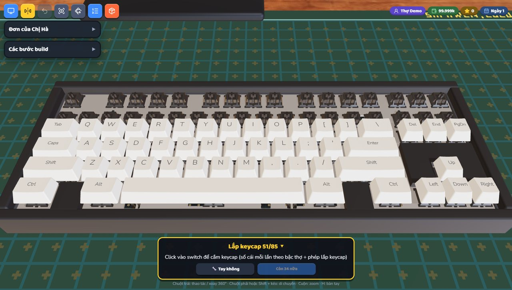            | 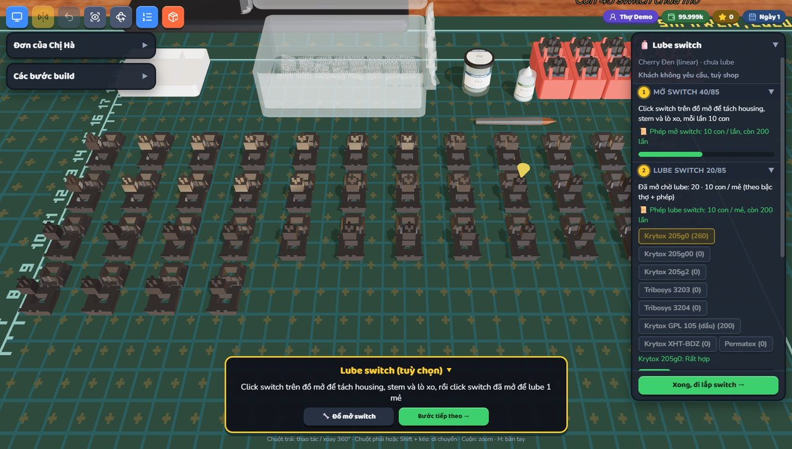                |
| **Top mount: bắt vít plate vào case trên**         | **O-ring mount: vòng silicon gá sau khi lắp switch** |
| 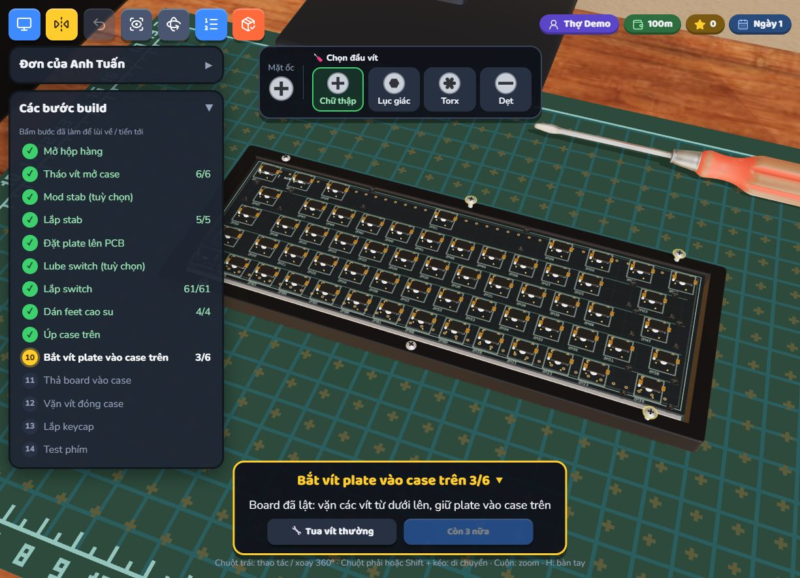            | 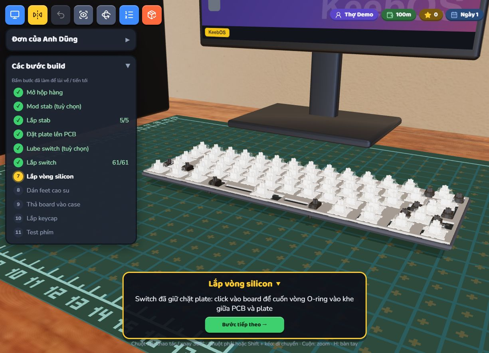         |
| **Hàn switch: giữ mỏ hàn, nhả trong vùng xanh**    | **Dán feet cao su vào hốc dưới đáy case**            |
| 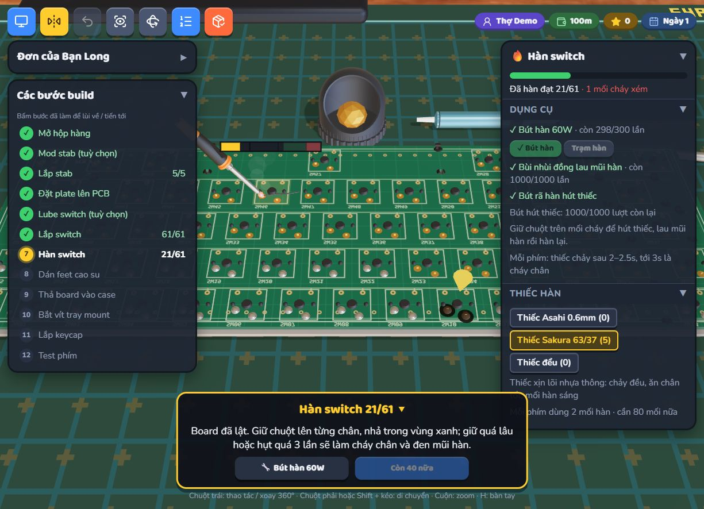          | 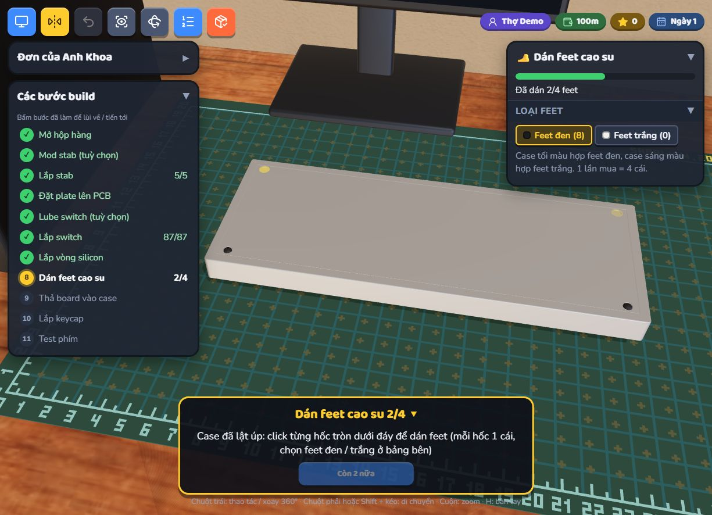                |
| **Shopii: switch mới (HMX, housing kim tuyến...)** | **Lót foam Poron giữa PCB và plate (0.1.9)**         |
| 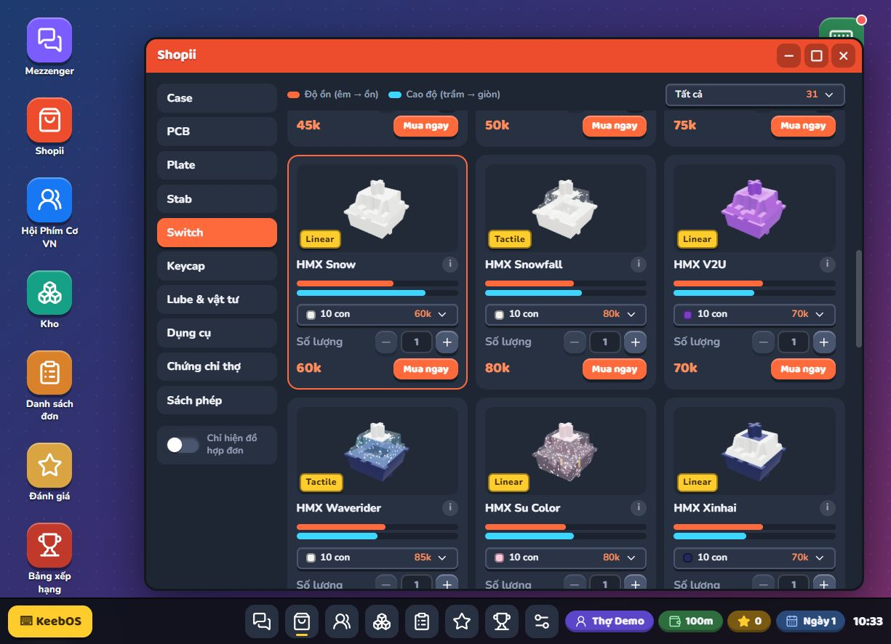    | 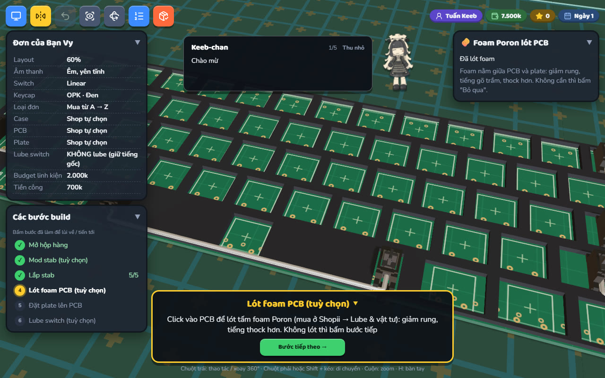                |
| **Plateless: switch cắm thẳng PCB hàn (0.1.9)**    | **Case mica: ốc xuyên tới tấm đáy (0.1.9)**          |
| 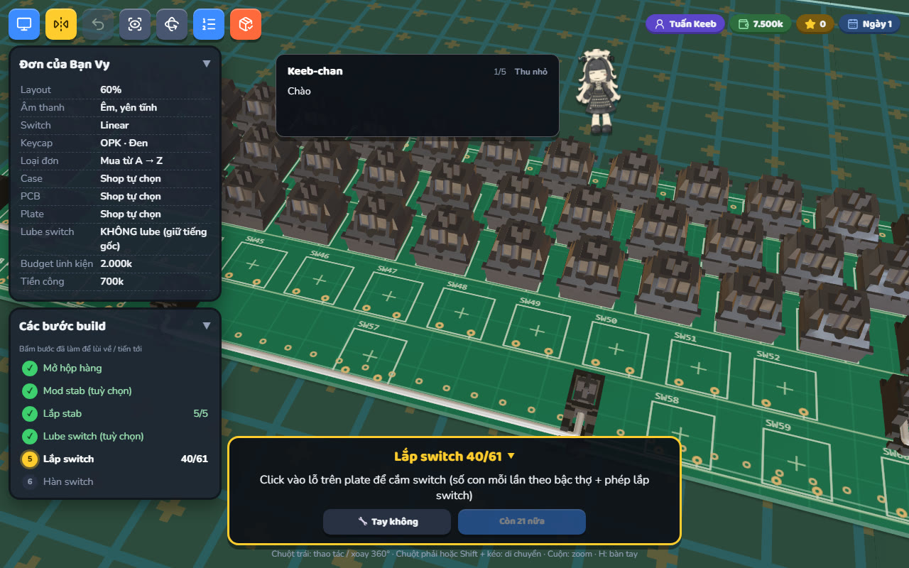            | 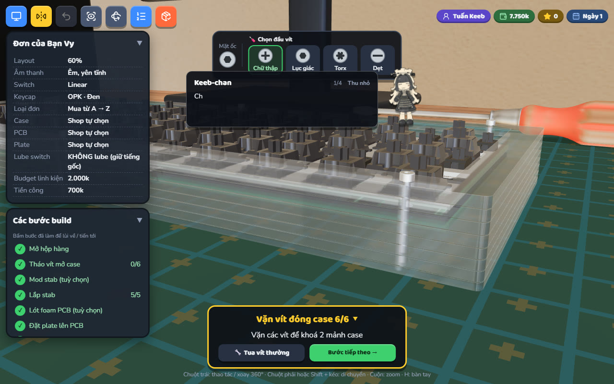             |
| **Kho: hàng lỗi viền đỏ, chỉ bán lại (0.1.9)**     | **Hội Phím Cơ: tự đăng bán, fast bid (0.1.9)**       |
| 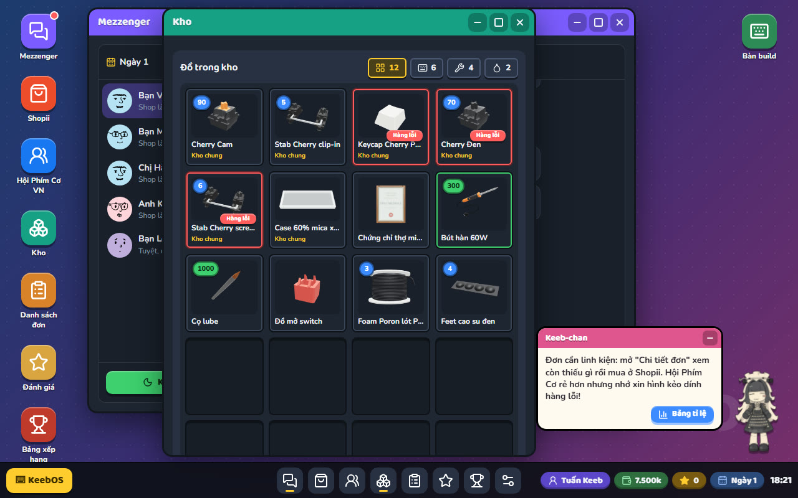               | 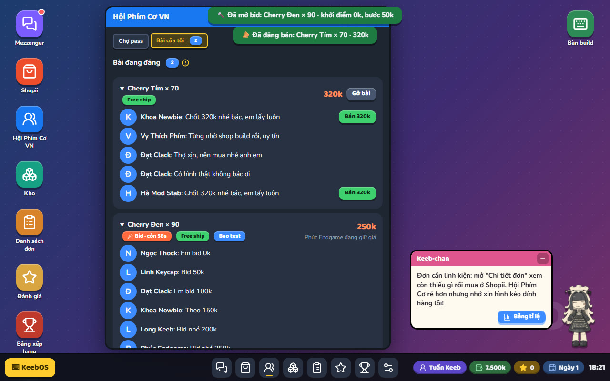               |

## Lịch sử cập nhật

<!-- prettier-ignore -->
| Phiên bản | Ngày | Mảng | Thay đổi chính |
| --- | --- | --- | --- |
| **0.1.16** | 29/10/2026 | 🖥️ Góc máy tính | Bàn có hộc (CPU trong ngăn kệ), màn hình ASUS chân chữ V, rèm lá gỗ sồi + khung cửa gỗ nâu, nền cửa sổ trắng như gương. |
| **0.1.15** | 29/10/2026 | 🚶 Phòng đi lại | Đi lại trong phòng bằng WASD (kiểu PC Building Simulator): bàn máy tính sát bàn build, hành lang nhận hàng, lịch treo tường kết thúc ngày; Shopii hẹn ngày giao (Hoả tốc / Nhanh / Tiết kiệm); mua linh kiện không bị chặn, món sale mua 1 lần. |
| **0.1.10** | 26/10/2026 | 🛒 Chợ & Keeb-chan | Bán đồ trong đơn đang build (switch lẻ, keycap chưa gắn), nút Đăng bán ở Kho; kéo Keeb-chan bằng nhân vật, không ra khỏi màn hình; tên game luôn chính giữa; Bid 1 phút → Fast bid. |
| **0.1.9** | 26/10/2026 | 🛒 Chợ & luật chơi | Đăng bán lời được (đại gia chốt đêm, chứng chỉ thợ +5% / bậc), fast bid 1 phút, tag Free ship, bán đồ trong đơn; hàng lỗi keycap / switch / stab chỉ bán lại; gỡ bài > 3 lần / ngày bị ban; qua ngày phải nhận ≥ 1 đơn, nhận không làm đền 20% công; điểm xếp hạng bỏ ngày. |
|  |  | ⌨️ Build | Plateless (PCB hàn + tray), foam Poron lót PCB (thock hơn), stab plate-mount dùng mọi plate, ốc case mica dài tới tấm đáy; Keeb-chan + màn tiêu đề dùng ảnh mới. |
| **0.1.8** | 26/10/2026 | 📊 Bảng tỉ lệ | Keeb-chan mở bảng tỉ lệ trong game (xem mục "Bảng tỉ lệ trong game"); chuộc phím khách +1 uy tín; app Đánh giá giải thích cách chấm sao. |
| **0.1.7** | 26/10/2026 | 🎀 Keeb-chan | Luôn ở góc màn hình, bấm nhân vật để ẩn / hiện lời nhắc, thanh tiêu đề như cửa sổ app (kéo để dời); ở bàn build hướng dẫn từng bước. |
|  |  | 🤝 Hội Phím Cơ | Tab dính trên cùng khi cuộn; lowball thành công ~30%; đi ăn xin 10% được free, 70% bị chặn, 20% bị ban chợ. |
| **0.1.6** | 26/10/2026 | 🛒 Đăng bán ở chợ | Tab "Bài của tôi" ở Hội Phím Cơ: bán đồ trong kho hoặc phím của khách (dễ bị lộ, chuộc lại được). |
|  |  | 🧪 Test phím | Phím chưa hàn không ăn, bước hàn sáng "!" để quay lại; giao khi chưa test hết có thể bị báo lỗi nút. |
|  |  | 🎀 Keeb-chan | NPC hướng dẫn nhắc mẹo theo tình huống; ở bàn build có hội thoại hướng dẫn từng bước. |
|  |  | 💾 Lưu tiến trình | Cài đặt có nút Lưu ghi bảng xếp hạng; đóng tab tự gửi. |
| **0.1.5** | 26/10/2026 | 🏆 Bảng xếp hạng | Xếp theo điểm tổng (đơn + uy tín + ngày + tiền), lọc theo từng thông số, khung loading khi tải. |
|  |  | 🔗 Gửi link | Gửi link game lên Facebook / Messenger / Zalo / Discord hiện banner + mô tả. |
| **0.1.4** | 26/10/2026 | 💍 O-ring mount | Vòng silicon gắn sau khi lắp switch / hàn, lúc switch đã giữ chặt plate. |
|  |  | 🪛 Tua vít thường | Vặn chậm theo cổ tay, xoay khớp với con ốc, không còn giật như tua vít điện. |
|  |  | 🏆 Bảng xếp hạng | Chạy trên Vercel (Vercel Function + Upstash Redis); xem mục "Deploy lên Vercel". |
| **0.1.3** | 26/10/2026 | 💀 Thua game | Uy tín từ −10 trở xuống hoặc hết tiền nhận đơn là thua; tự tuyên bố phá sản ở Cài đặt. |
|  |  | 🏆 Bảng xếp hạng | Server riêng (`bun run server`), gồm lượt chơi đã kết thúc của mọi người, xếp theo tiền; tiền gọn k → m → B. |
|  |  | 🦶 Feet cao su | Bước mới trước khi lắp case: case tự lật úp, dán feet đen / trắng vào 4 hốc CNC; Shopii bán vỉ 4 cái. |
|  |  | 🧩 Case theo cụm phím | Khối chặn liền case tách theo cụm (TKL / full / FRL / 75 / 65); tấm mica trên plate khoét theo cụm. |
|  |  | 🔩 Case & mount | Case 2 mảnh có lỗ vít (nhôm / PC / acrylic ở đáy, mica xuyên mọi tấm); case 1 mảnh chơi tray / O-ring / OG; thêm Case TKL nhôm 1 mảnh. |
|  |  | 🛒 Shopii | Case cùng dòng gộp 1 sản phẩm (chọn chất liệu rồi màu), ghi cỡ layout; ô nhập số lượng khi mua. |
|  |  | 📦 Đơn hàng | Có đơn đòi đích danh 1 loại switch; switch phải hợp kiểu âm thanh khách muốn. |
|  |  | 🎨 Switch & màu case | Otemu Silent, Cherry Tím / Cam, Gateron Type R / Milky / Silent Tactile, HMX, Wingtree, Ruben Bumblebee..., housing kim tuyến; case thêm tím, coffee sữa, nâu đậm, đỏ + navy. |
|  |  | 📱 Giao diện | Tối ưu cho điện thoại: taskbar, hộp thoại, HUD bàn build, camera; nhãn keycap ở Hội Phím Cơ hết đè nhau. |
| **0.1.2** | 25/10/2026 | 🗃️ Kho chung | Đồ mua dư / bị thay / thừa sau khi giao không mất; nhận hoặc chuyển đơn tự lấy món hợp yêu cầu; Kho hiện cả đồ đơn đang chờ. |
|  |  | 💰 Tiền & đơn hàng | Giao xong khách trả đủ budget linh kiện (mua rẻ thì lãi); đơn có thể đòi đích danh case / stab / chất liệu plate / chất liệu keycap. |
|  |  | 🛒 Shopii | Bộ stab TKL + stab lẻ theo cỡ dây; bộ lọc ô đổ xuống ở mọi mục, "Chỉ hiện đồ hợp đơn"; keycap 3 chất liệu PBT / Mix / ABS; sách phép gói 100 / 200 / 500. |
|  |  | 🤝 Hội Phím Cơ | Tự nhập giá trả (3 lần / người bán); "Đi ăn xin" xin free, 5% được cho, còn lại bị ban chợ 3 ngày. |
|  |  | 🎵 Âm thanh & app | Nhạc nền xoay 3 bài; app Bảng xếp hạng (so với shop đối thủ); Đánh giá có badge uy tín; Silent Tactile thành loại riêng. |
|  |  | 🐛 Sửa lỗi | Plate 60% lật gương, case Planck xoay ngược, feet lệch hốc, camera xoay khi hàn, mỡ wire stab dài, chữ keycap SA bị che. |
| **0.1.1** | 25/10/2026 | 📜 Lịch sử & tài liệu | Bấm số phiên bản ở màn hình tiêu đề xem lịch sử cập nhật; README có ảnh demo; dọn code không dùng. |
|  |  | 🤝 Hội Phím Cơ | Ngày mới đăng đợt hàng pass mới; người bán có giá sàn ~60%, hết bị trả giá về 0đ. |
| **0.1.0** | 25/10/2026 | 📖 Sách phép | Phép mở / lube / lắp switch, lắp keycap, hàn, rã hàn (200 lần / cuốn): thợ lõ 10 con mỗi lần, có chứng chỉ cộng thêm 10. |
|  |  | 🛠️ Bàn build | Mũi tên vàng chỉ phím cần hàn / bùi nhùi; sắp lại bàn lube; stab nhiều kiểu, case top mount; cải thiện camera, HUD, luồng app. |
|  |  | ⌨️ Layout & dụng cụ | Layout 65%, 75%, FRL, Planck, Alice; bút hút thiếc, giá cuộn thiếc, bùi nhùi, chứng chỉ thợ; chấm chất lượng mối hàn. |
|  | 23/10/2026 | 🖥️ Desktop | Cải thiện desktop giả lập và cài đặt âm thanh. |

Chi tiết từng mục: [src/data/changelog.ts](src/data/changelog.ts) (hoặc bấm số phiên bản trong game).

## Bảng tỉ lệ trong game

Trong game: bấm **📊 Bảng tỉ lệ** ở bong bóng Keeb-chan (góc phải màn hình máy tính). Số liệu lấy từ `src/data/odds.ts`.

<!-- prettier-ignore -->
| Mảng | Tình huống | Tỉ lệ |
| --- | --- | --- |
| **🤝 Mua hàng pass ở Hội Phím Cơ** | Người bán liêm (mô tả đúng tình trạng) | 60% |
|  | Người bán bùng tiền | 8% người liêm · 30% người không liêm |
|  | Check var lục được bài tố người bùng | 70% |
|  | Hàng lỗi: case / plate / PCB | 45% / 35% / 35% |
|  | Hàng lỗi: keycap / switch / stab (không lắp cho khách được, chỉ bán lại, giá còn 1 nửa) | 55% / 40% / 40% |
|  | Bài "Price no offer" · "Fs" (free ship) · "câm điếc" | 25% · 35% · 30% |
|  | Hỏi han bài "câm điếc" bị chặn (mỗi câu) | 30% |
|  | Xin lộc bài "Price no offer" bị chặn | 40% |
|  | Chốt nhanh được bớt 100–200k | 65% |
|  | Lowball (trả 70%) bài thường | 25% bị chặn · 30% được |
|  | Lowball bài "Lowball thoải mái" | 5% bị chặn · 52% được |
|  | Lowball bài "Price no offer" | 100% bị chặn |
|  | Đi ăn xin | 10% được free · 70% bị chặn · 20% ban chợ 3 ngày |
| **💸 Tự đăng bán / bán phím của khách** | Bán phím của khách mà khách không phát hiện | 5% |
|  | Bị lộ | 95% · −1 uy tín |
|  | Chuộc lại phím (giá ×1.1 ~ ×1.3 giá đã bán) | 30% bị từ chối · được thì +1 uy tín, giữ 3 ngày |
|  | Đăng trên giá chợ tới 1.4× giá gốc: đại gia chốt trong đêm (tối đa 1 đại gia / đêm) | 15% · +5% mỗi bậc thợ · +5% nếu Free ship |
|  | Đăng > 1.2× giá gốc: bị chê (có chứng chỉ thì bớt chê, có người khen) | 35% (> 1.4×: 60%) mỗi lượt bot ghé · −5% mỗi bậc thợ |
|  | Fast bid (1 phút): giá chốt | ~45% → 125% giá chợ (có thể lời / lỗ) · khởi điểm ≤ giá sàn (45% giá chợ) chắc chắn có người bid |
|  | Bán hàng lỗi bị tố mô tả sai sự thật | 10% · admin ban chợ 3 ngày |
|  | Gỡ bài quá 3 lần / ngày | Admin ban chợ 3 ngày |
| **🔧 Lắp ráp & giao hàng** | Thiếc đểu cháy chân dù nhả đúng vùng xanh | 15% |
|  | Giao khi chưa test hết phím: khách báo 1 nút lỗi | 5% |
|  | Còn switch chưa hàn / hàn cháy | Test: phím không nhận · giao đi: khách báo nút không nhận tín hiệu (100%, tối đa 2 sao) |
| **📨 Đơn hàng** | Đơn kit (khách gửi sẵn vài món) | ~50% |
|  | Yêu cầu đúng loại switch (1 mẫu cụ thể) | 35% |
|  | Đòi đích danh case / stab / plate | 30% mỗi món |
|  | Đòi chất liệu keycap | 80% |
|  | Muốn lube · cấm lube · tuỳ shop | 40% · 20% · 40% |
|  | Qua ngày mà đơn đã nhận cả ngày không làm (khách report) | Đền 20% tiền công mỗi đơn |

## Tài liệu

- [Tổng quan source và luồng game](docs/OVERVIEW.md)
- [Nhật ký quyết định](docs/decisions/README.md)

## Cách chơi

- Nhận đơn trong **Mezzenger**, đọc kỹ layout, loại switch, keycap, âm thanh, mount, ngân sách và hạn giao.
- Mua linh kiện đúng yêu cầu ở **Shopii**; món khách gửi trong kit thì không cần mua. **Hội Phím Cơ VN** bán đồ pass rẻ hơn nhưng có khoảng 20% rủi ro bị bùng tiền.
- Chọn mount trước khi build, rồi ra **bàn build 3D** và làm theo danh sách bước trên HUD.
- Stab plate-mount gài được mọi plate. **Plateless** (bật ở app Danh sách đơn): bỏ plate, bắt buộc PCB hàn + Tray mount. **Foam Poron** lót PCB (Shopii → Lube & vật tư) là bước tuỳ chọn trước plate, tiếng thock hơn.
- Kết thúc ngày lúc nào cũng được (không bắt nhận đơn); đơn đã nhận mà cả ngày không làm gì thì khách report, đền 20% tiền công.
- Trước khi lắp board vào case phải dán 4 feet cao su vào hốc dưới đáy case: mua feet đen / trắng ở Shopii → Lube & vật tư (1 lần mua = 4 cái).
- Hàn / vặn vít vào: bấm cho kim chạy, bấm lần nữa (hoặc Space) dừng trong vùng xanh, trúng vàng là hoàn hảo; lau mũi hàn khi bị cháy. Lube switch thì mở vỏ trước; mod stab theo đúng mẫu; chọn đúng đầu vít (sai là trượt ren, 3 lần thì tuôn) và dừng kim lực trong vùng xanh — quá tay là tuôn ren / nứt case, giao đi phải đền khách.
- Test bằng bàn phím thật hoặc click phím 3D; càng nhiều phím được test càng cao điểm.
- Bấm **Đóng gói đơn này** để chấm điểm, sau đó gửi khách trong Mezzenger (hoặc để **Kết thúc ngày** gửi nốt).
- Tiền nhận gồm budget linh kiện (mua rẻ hơn thì phần dư vào túi) + tiền công theo điểm; lố ngân sách thì shop chịu phần lố và bị trừ điểm.
- Kho chung của shop: mọi linh kiện mua dư / bị thay / thừa sau khi giao đều nằm trong Kho, nhận hoặc chuyển đơn thì tự lấy món hợp yêu cầu, chỉ cần mua phần thiếu.
- **Test hết phím trước khi giao**: phím chưa hàn sẽ không ăn và khách báo lỗi nút; bỏ sót test thì 5% khách gặp nút lỗi (đánh giá thấp).
- Hội Phím Cơ → **Bài của tôi**: tự đăng bán đồ trong kho, đồ trong đơn chưa build hoặc… phím của khách (95% bị lộ, −1 uy tín; chuộc lại trên chợ thì gỡ được uy tín). Đăng giá cố định (giá cao tới 1.4× giá gốc vẫn có thể gặp đại gia chốt trong đêm) hoặc fast bid 1 phút. Gỡ bài quá 3 lần / ngày bị admin ban.
- Hàng pass lỗi keycap / switch / stab (viền đỏ trong Kho) không lắp cho khách được, chỉ đăng bán lại.
- **Esc**: đang ngồi máy tính / bàn build thì đứng dậy ra phòng, đang đi lại thì không làm gì (Esc chỉ để thoát, không vào máy tính). Cài đặt có nút xanh **Lưu tiến trình** ghi lên bảng xếp hạng (đóng tab cũng tự gửi). Keeb-chan hướng dẫn mẹo chơi, tắt / bật ở Cài đặt.
- Giữ đơn trong hạn để tránh mất uy tín; đơn chờ trễ quá 3 ngày sẽ bị khách huỷ. Dụng cụ có độ bền và chứng chỉ thợ giúp lắp / lube nhanh hơn.
- **Thua game** khi uy tín từ −10 trở xuống (bị phốt quá nhiều) hoặc rảnh tay mà ví không đủ mua linh kiện cho đơn rẻ nhất. Có thể tự **tuyên bố phá sản** ở Cài đặt. Thua / phá sản / chơi mới đè bản lưu thì kết quả được ghi lên bảng xếp hạng server (app **Bảng xếp hạng**, xếp theo điểm tổng của số đơn + uy tín + số ngày + tiền, lọc lại được theo từng thông số).

## Yêu cầu

- [Bun](https://bun.sh/) 1.4.3 trở lên

## Bắt đầu

```powershell
bun install
bun run dev
```

## Các lệnh thường dùng

| Lệnh                   | Mục đích                                                       |
| ---------------------- | -------------------------------------------------------------- |
| `bun run dev`          | Chạy môi trường phát triển Vite.                               |
| `bun run server`       | Chạy server bảng xếp hạng (cổng 8787, Vite proxy `/api`).      |
| `bun run build`        | Kiểm tra TypeScript và tạo bản build production trong `dist/`. |
| `bun run preview`      | Xem trước bản build production.                                |
| `bun run typecheck`    | Kiểm tra kiểu TypeScript.                                      |
| `bun run lint`         | Kiểm tra JavaScript/TypeScript bằng ESLint.                    |
| `bun run lint:fix`     | Tự sửa các lỗi ESLint có thể sửa an toàn.                      |
| `bun run format`       | Format source bằng Prettier và sắp xếp class Tailwind.         |
| `bun run format:check` | Kiểm tra source đã đúng định dạng hay chưa.                    |

## Deploy lên Vercel

- Vercel tự nhận dự án Vite (cài bằng Bun theo `bun.lock`, build `bun run build` → `dist/`), không cần `vercel.json`.
- Bảng xếp hạng chạy bằng Vercel Function `api/leaderboard.ts`, lưu ở **Upstash Redis**: vào project trên Vercel →
  **Storage** (Marketplace) → thêm **Upstash Redis** và nối vào project. Vercel tự gắn `KV_REST_API_URL` / `KV_REST_API_TOKEN`
  (tạo database Upstash tay thì đặt `UPSTASH_REDIS_REST_URL` / `UPSTASH_REDIS_REST_TOKEN`), rồi deploy lại.
- Client gọi `/api/leaderboard` cùng domain nên không cần đặt `VITE_LEADERBOARD_URL`. Chưa nối Redis thì API trả 503, kết quả
  lượt chơi nằm trong hàng chờ ở máy người chơi và gửi lại khi mở app Bảng xếp hạng.
- Danh sách biến môi trường + giải thích: [.env.example](.env.example). File `.env` không có tác dụng trên Vercel, phải đặt
  ở Settings → Environment Variables (môi trường **Production**) rồi **Redeploy**; API còn trả 503 thì phản hồi liệt kê tên biến
  Redis đang thấy để dò.
- Chạy local vẫn dùng `bun run server` (lưu file JSON), Vite proxy `/api` về đó.

## Quy ước mã nguồn

- Bun là package manager duy nhất; dùng `bun install` và `bun run <script>`.
- Mọi tệp văn bản trong repository dùng LF. `.gitattributes`, `.editorconfig` và Prettier cùng áp dụng quy tắc này.
- Prettier dùng dấu nháy đơn, không dùng dấu chấm phẩy, và plugin `prettier-plugin-tailwindcss` để sắp xếp class Tailwind theo chuẩn.
- ESLint sử dụng flat config cho TypeScript, React Hooks và React Refresh.
