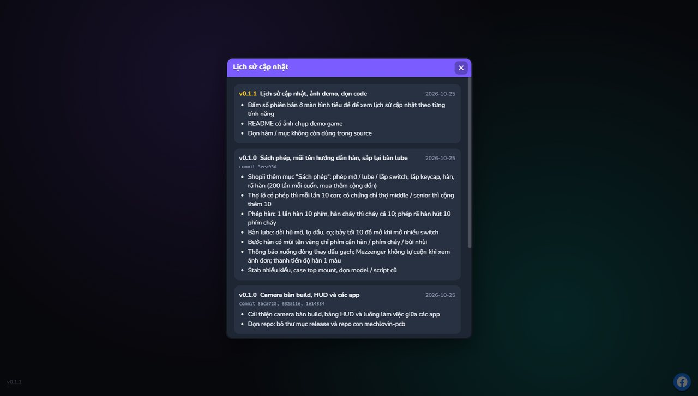

# Keyboard Builder Simulator

Mô phỏng quy trình build bàn phím cơ: nhận đơn, mua linh kiện, lắp ráp và giao hàng.
Ứng dụng được xây dựng bằng React, TypeScript, Vite, Tailwind CSS và React Three Fiber.

Các file CAD bàn phím, case, plate và PCB công khai dùng làm nguồn cho game nằm tại [assets/community](assets/community/README.md), kèm nguồn và giấy phép.

## Ảnh demo


| Nhận đơn ở Mezzenger                    | Mua đồ ở Shopii (Sách phép)                 |
| --------------------------------------- | ------------------------------------------- |
|  |  |
| **Bàn build 3D: lắp keycap**            | **Bàn lube: mở và lube switch**             |
|  |        |

Bấm số phiên bản ở góc màn hình tiêu đề để xem lịch sử cập nhật:



## Tài liệu

- [Tổng quan source và luồng game](docs/OVERVIEW.md)
- [Nhật ký quyết định](docs/decisions/README.md)

## Cách chơi

- Nhận đơn trong **Mezzenger**, đọc kỹ layout, loại switch, keycap, âm thanh, mount, ngân sách và hạn giao.
- Mua linh kiện đúng yêu cầu ở **Shopii**; món khách gửi trong kit thì không cần mua. **Hội Phím Cơ VN** bán đồ pass rẻ hơn nhưng có khoảng 20% rủi ro bị bùng tiền.
- Chọn mount trước khi build, rồi ra **bàn build 3D** và làm theo danh sách bước trên HUD.
- Trước khi lắp board vào case phải dán 4 feet cao su vào hốc dưới đáy case: mua feet đen / trắng ở Shopii → Lube & vật tư (1 lần mua = 4 cái).
- Hàn đúng vùng xanh và đừng giữ quá lâu; lau mũi hàn khi bị cháy. Lube switch thì mở vỏ trước; mod stab theo đúng mẫu; chọn đúng đầu vít.
- Test bằng bàn phím thật hoặc click phím 3D; càng nhiều phím được test càng cao điểm.
- Bấm **Đóng gói đơn này** để chấm điểm, sau đó gửi khách trong Mezzenger (hoặc để **Kết thúc ngày** gửi nốt).
- Tiền nhận gồm budget linh kiện (mua rẻ hơn thì phần dư vào túi) + tiền công theo điểm; lố ngân sách thì shop chịu phần lố và bị trừ điểm.
- Kho chung của shop: mọi linh kiện mua dư / bị thay / thừa sau khi giao đều nằm trong Kho, nhận hoặc chuyển đơn thì tự lấy món hợp yêu cầu, chỉ cần mua phần thiếu.
- Giữ đơn trong hạn để tránh mất uy tín; đơn chờ trễ quá 3 ngày sẽ bị khách huỷ. Dụng cụ có độ bền và chứng chỉ thợ giúp lắp / lube nhanh hơn.
- **Thua game** khi uy tín từ −10 trở xuống (bị phốt quá nhiều) hoặc rảnh tay mà ví không đủ mua linh kiện cho đơn rẻ nhất. Có thể tự **tuyên bố phá sản** ở Cài đặt. Thua / phá sản / chơi mới đè bản lưu thì kết quả được ghi lên bảng xếp hạng server (app **Bảng xếp hạng**, xếp theo tiền).

## Yêu cầu

- [Bun](https://bun.sh/) 1.4.3 trở lên

## Bắt đầu

```powershell
bun install
bun run dev
```

## Các lệnh thường dùng

| Lệnh                   | Mục đích                                                       |
| ---------------------- | -------------------------------------------------------------- |
| `bun run dev`          | Chạy môi trường phát triển Vite.                               |
| `bun run server`       | Chạy server bảng xếp hạng (cổng 8787, Vite proxy `/api`).      |
| `bun run build`        | Kiểm tra TypeScript và tạo bản build production trong `dist/`. |
| `bun run preview`      | Xem trước bản build production.                                |
| `bun run typecheck`    | Kiểm tra kiểu TypeScript.                                      |
| `bun run lint`         | Kiểm tra JavaScript/TypeScript bằng ESLint.                    |
| `bun run lint:fix`     | Tự sửa các lỗi ESLint có thể sửa an toàn.                      |
| `bun run format`       | Format source bằng Prettier và sắp xếp class Tailwind.         |
| `bun run format:check` | Kiểm tra source đã đúng định dạng hay chưa.                    |

## Quy ước mã nguồn

- Bun là package manager duy nhất; dùng `bun install` và `bun run <script>`.
- Mọi tệp văn bản trong repository dùng LF. `.gitattributes`, `.editorconfig` và Prettier cùng áp dụng quy tắc này.
- Prettier dùng dấu nháy đơn, không dùng dấu chấm phẩy, và plugin `prettier-plugin-tailwindcss` để sắp xếp class Tailwind theo chuẩn.
- ESLint sử dụng flat config cho TypeScript, React Hooks và React Refresh.
